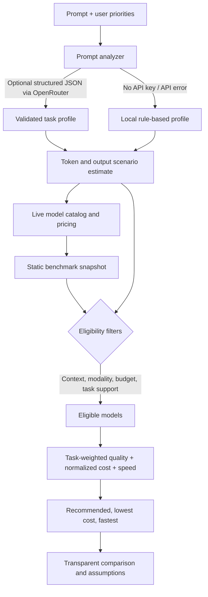

# Model Atlas: recommendation flow

## Implementation sequence

1. Keep prompt analysis, token/cost estimation, and recommendation as separate modules.
2. Fetch catalog metadata and token prices from OpenRouter's public model catalog; fall back to a small local catalog when it is unavailable.
3. Use an optional OpenRouter key only for structured prompt classification. Validate and clamp every field; rules remain the no-key path.
4. Estimate input tokens using a conservative text heuristic until a provider tokenizer is wired in. Output length is a user-selected scenario, never presented as known.
5. Filter hard constraints before ranking. Calculate task fit from a versioned local benchmark snapshot, normalize cost and latency among eligible models, and combine them using user weights.
6. Show sources, freshness, assumptions, and score breakdown beside the recommendation. Never present a benchmark snapshot as live or a prediction as a guarantee.

## Formula

`estimated_cost = input_tokens / 1_000_000 * input_price_per_million + output_tokens / 1_000_000 * output_price_per_million`

For each eligible model, task-fit quality is the weighted average of its relevant benchmark dimensions. Lower cost and latency are normalized to 0–100 across the eligible set (equal values score 100). The final score is `quality_weight * quality + cost_weight * cost_score + speed_weight * speed_score`; weights are normalized to sum to 1. A hard budget is applied as an eligibility rule before scores are calculated.

Benchmark scores in the initial static file are prototype priors and are explicitly labeled as such. Replace them with a dated, reproducible evaluation run before making production-quality claims.
